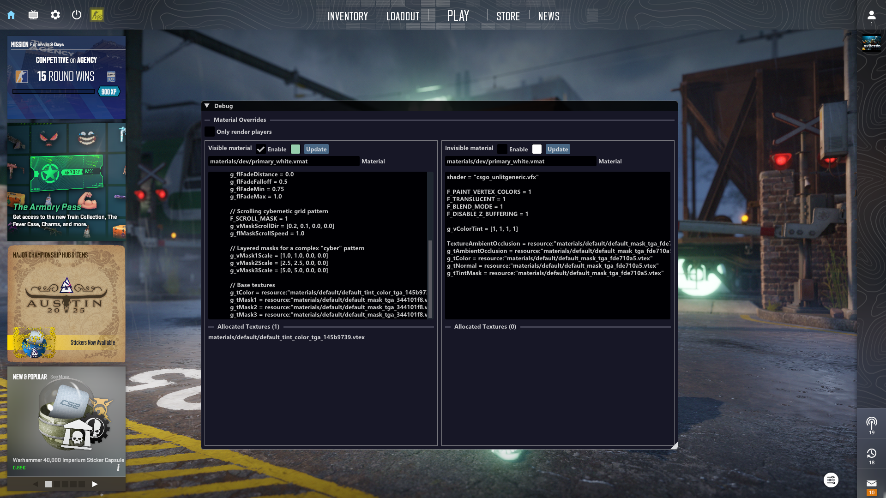

# CS2 Material Editor

A simple in-game material editor for Counter-Strike 2, built with ImGui.  
It allows real-time editing of visible and invisible player materials:

## Preview

## Features

- Separate configuration for visible and invisible chams.
- Real-time color editing.
- Editable material path and definition.
- Displays precached allocated textures (will not work if loading a second time currently).
- Instant update.

## Usage

1. Inject the material editor using any injector (process hacker for example).
2. Open the menu in-game.
3. Configure visible and invisible materials as desired.
4. Press **Update** to reload the material.

---

**Note:** Make sure your material paths are valid `.vmat` files to avoid crashes
